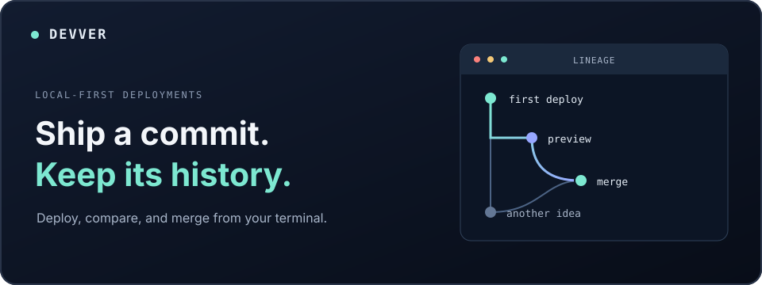

<div align="center">

# Devver

**The fast lane from code to feedback.**

[Get started](#get-started) · [Cloud or local](#cloud-or-local) · [Install](#install) · [Contribute](#contribute)

[](https://github.com/Devver-Inc/cli/actions/workflows/ci.yml) [](https://www.npmjs.com/package/@devver-inc/cli) [](https://github.com/Devver-Inc/cli/releases)



</div>

Devver is a test deployment service for the space between writing code and shipping a feature. Deploy a revision in the cloud to share with your team, or run it locally to test on your own machine. Get a URL, collect feedback through the tools your team already uses, iterate with people and agents, then move on to the next feature.

Cloud and local are explicit choices. A local URL stays on your machine; use the cloud when teammates need to open the deployment.

## Get started

Install the CLI, then choose where you want to test:

```sh
npm install -g @devver-inc/cli
```

### Test locally

For a Git checkout containing a committed static site (for example, an `index.html` at its root):

```sh
devver new server demo    # once; creates and attaches a local server
cd /path/to/your/site
devver deploy --open       # deploy the committed revision and open its URL
```

Open `devver` to browse previous deployments. The local server stays attached for future commands; use `devver server status` to inspect it or `devver detach` to clear the selection.

### Share through the cloud

From a Git checkout with a Devver cloud project:

```sh
devver cloud
devver auth login
devver project list        # select your project
devver init                # create the project's config if needed
devver deploy              # prints the deployment URL
```

Send the cloud URL to teammates or use it in your agent-assisted review workflow. Cloud deployment needs an account, project, and supported project configuration; `--open` currently works only for local deployments.

## Cloud or local

|  | Local | Cloud |
| :-- | :-- | :-- |
| **Best for** | Testing a committed static site on your own machine | Sharing a test deployment with your team |
| **Setup** | `devver new server <name>`; no account | `devver cloud` and `devver auth login` |
| **URL** | Loopback; not publicly shareable | Share the URL printed by `devver deploy` |

Every deployment gives you a concrete revision to test and discuss. In the terminal UI, you can navigate local deployment history and explicitly merge two ready versions without changing your checkout. Devver does **not** collect feedback for you; share the cloud URL in the conversations and tools where your team already works.

> [!IMPORTANT]
> Local deployments run with **your user account's permissions**. Only deploy code you trust; local servers are not a sandbox. Their API and proxy bind to loopback.

See [AGENTS.md](AGENTS.md) for the CLI/server architecture, [packages/README.md](packages/README.md) for package boundaries, and [GitHub issues](https://github.com/Devver-Inc/cli/issues) for work in progress.

## Install

| Channel | Command | What you get |
| :-- | :-- | :-- |
| Stable | `npm install -g @devver-inc/cli` | Latest stable release |
| Nightly | `npm install -g @devver-inc/cli@nightly` | Builds from `develop` |
| Preview | `npm install -g @devver-inc/cli@dev` | Opt-in development build |

The npm package installs the native executable for your platform. **Node is needed to install it, not to run `devver` or its packaged server; Bun is not needed at runtime either.** Supported native packages are macOS Apple Silicon and Linux x64. Windows releases are paused pending runtime verification. Local static serving bundles its tools, so server startup does not download them.

Standalone binaries are available from [GitHub Releases](https://github.com/Devver-Inc/cli/releases). Keep each CLI with its matching versioned server. To update a supported global npm install, run `devver --update`; Homebrew stable installs use `brew update && brew upgrade devver-cli`. Source builds and standalone downloads do not self-update. Existing supervised local servers retain their pinned binaries after a CLI update.

## Contribute

Development uses [Bun](https://bun.sh) and Node for tooling. From the repository root:

```sh
bun install
bun run dev          # run the CLI from source, with restarts
bun run check        # format, lint, and type-check
bun test             # full test suite
```

`bun run build` produces standalone CLI and server executables. For a disposable local-server test, use `mise run dev-local`. Every PR needs a Changeset: `mise run bump` for a release change, or `mise run no-release` for a change without a bump. The root package version is the committed baseline; pending Changesets on `develop` determine the next planned version.

`develop` carries nightly builds; `main` carries stable releases. A maintainer runs the **Release** workflow on `main` with an empty tag field to version, test, tag, and publish a new stable release. To resume a failed publish after tagging, rerun it with the existing `v*` tag. Merge its release commit back into `develop` before the next nightly. See [the release workflow](.github/workflows/release.yml) for the exact steps and [AGENTS.md](AGENTS.md) for project conventions.

Found a bug or have an idea? [Open an issue](https://github.com/Devver-Inc/cli/issues).
